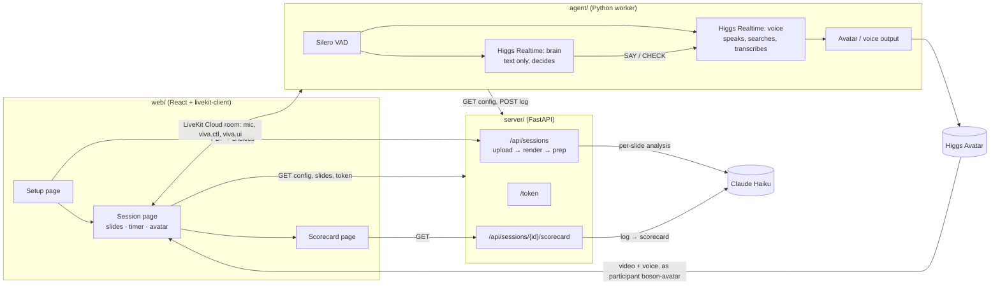

# Viva: an AI examiner for presentation defenses

**You present your slides. An examiner listens, cuts in when a claim doesn't hold up, keeps you to time, fact-checks you on the web, follows your answers in Indonesian or Mandarin, runs Q&A, and gives you a scorecard.**

Built for the Boson AI × MScAC Higgs Audio Hackathon 2026, track *Put a Face to the Voice*. The examiner is a [Higgs Avatar](https://docs.boson.ai) driven by `higgs-realtime-1.5-preview`.

<!-- TODO before submission: demo video link. -->
**Demo video:** _TODO_ · **Team Viva:** Joel Rompis ([@DaWanAnOnli](https://github.com/DaWanAnOnli)) and KeHan Xiao ([@kehanxiao](https://github.com/kehanxiao))

## The problem
Every AI is built to be your assistant. Practising a thesis defense, a capstone presentation or an assignment oral needs the opposite: an **examiner**. Someone who stops you at the weak claim, asks "better than *what*?", and doesn't let you run over time. Students rarely get to rehearse in front of a real examiner. Viva gives them one that is demanding but fair, and that tells them afterwards exactly where they lost marks.

## What it does
| | |
|---|---|
| **Knows your slides** | Before the session, Claude Haiku reads every slide (image + text) and lists its claims, weak points and likely questions. During the session, the examiner always knows which slide you're on. She learns a slide's weak points only after you have talked about it for about 5 s, so she challenges what you say, not what you haven't reached yet. |
| **Interrupts at the next breath** | A second Higgs Realtime session listens to you as the examiner's judgment. When you make a weak claim ("our model is 40% better") or contradict yourself, the examiner cuts in at your next pause: *"Better than what? What's the baseline?"* It pushes back on a weak answer and insists when you dodge. |
| **Won't be talked over** | Talk over her and she stops, then decides: *"Let me finish."*, or she answers what you said. Time reminders, fact-checks and the verdict can't be talked over. |
| **Holds the floor** | When the examiner speaks, it keeps the floor briefly instead of yielding to the first sound you make. |
| **Keeps time, and checks you listened** | It gives a reminder at T−2 min (T−1 for a talk under 5 minutes, e.g. "1 minute left" at 2:00 of a 3-minute one) and at time-up. If you talk straight through a reminder, it escalates once: *"Let me stop you there."* The reminder also appears on screen. |
| **Keeps you going** | Go quiet for 4 s while she isn't speaking or searching, and she urges you on: *"Please continue."* (at most twice per silence). |
| **Fact-checks on the web** | Checkable claims about the outside world ("LightGBM, released by Google in 2020") are verified with Higgs's server-side web search and corrected out loud. |
| **Runs Q&A, and follows your language** | In Q&A it asks questions from the weak points it found. In the talk and in Q&A you can answer in Indonesian or Mandarin, or mix them with English: she follows you and replies in English. A session with no Q&A time (`qa_s: 0`) skips Q&A and the verdict: time-up ends the exam. |
| **Scorecard** | A spoken verdict, then a page with scores for clarity, rigour, handling questions and time management, timestamped strong and weak moments quoting your own words, ignored reminders, and the top 3 improvements. |
| **Custom examiner** | Three preset characters (The Skeptic, The Supervisor, The Industry Panelist), each with its own persona and avatar; The Skeptic also cuts in sooner and presses a point twice. Add a free-text brief of your own. The character, not hard-coded rules, decides how often she interrupts and for what. |

## How it uses Higgs
- **Higgs as the examiner's brain.** A second, text-only Realtime session (`output_modalities: ["text"]`) hears the same audio and, at each pause, answers one line: `SILENT`, `SAY: <words>` or `CHECK: <claim>`. It hears your voice directly, so there's no wait for a transcript. On a talk with 6 planted errors it caught 6/6 at a median of ~0.45 s per decision. Claude Haiku reading transcripts caught 5–6/6 at 1.5–1.9 s (`agent/probes/higgs_brain.py`).
- **Two keys, optional.** With the brain on its own key (`BOSON_BRAIN_API_KEY`), the voice starts ~0.35 s after the brain's decision. On one shared key, a response asked for right after another one starts ~1.6 s late, so the voice waits 0.8 s instead (`agent/probes/two_session_latency.py`).
- **The brain's memory is kept true to what was heard.** Her words reach it in the past tense, at the moment the room hears them. A line that was never spoken (blocked as a third repeat, or overtaken by something else) is deleted from its conversation (`conversation.item.delete`).
- **Manual turn control** (`turn_detection: null`) on both sessions. Presenter audio streams continuously. Our own VAD commits a chunk at each breath, which gives a transcript **without** an automatic reply. We decide when the examiner speaks: the voice session says the brain's line word for word (`response.create` with per-response instructions). That is what makes interruptions, holding the floor and our own barge-in policy possible.
- **Clean cancellation:** `response.cancel` → avatar `clear_buffer()` → `conversation.item.truncate`, so the transcript matches what was actually heard (the server confirms the cancel in about 31 ms).
- **Server-executed `web_search`** for live fact-checks.
- **Code-switching:** answers in Indonesian or Mandarin (or mixed) are understood from the audio, in the talk and in Q&A. `higgs-stt-3.1` transcribes the presenter for the session log and the scorecard. Nothing is shown on screen: the interface is voice only.
- **Higgs Avatar** realtime sessions on LiveKit Cloud (preset avatars), with a voice-only fallback (`VIVA_AVATAR=0`).
- Phase changes (presentation → Q&A → debrief) use a mid-session `session.update` of the instructions (Q&A also removes `web_search`).

## Architecture


- **`web/`**: Vite + React + TypeScript. The Session page talks to the agent over LiveKit text streams: `viva.ctl` (start, slide changes, phases) and `viva.ui` (examiner state, reminders, fact-checks, latency). The agent also sends transcript captions, but the page doesn't show them: the interface is voice only.
- **`server/`**: FastAPI. Mints LiveKit tokens, renders uploaded PDFs with PyMuPDF, runs the per-slide Haiku analysis in parallel (structured outputs), serves the session config to the agent, stores the session log and generates the scorecard.
- **`agent/`**: a hand-built worker. It joins the room, starts the avatar and drives a raw Higgs Realtime WebSocket. It owns turn-taking around the brain: VAD commits, when the brain is asked, holding the floor, being talked over, the timer, phases, fact-checks and the session log.
- The A↔B interface (identities, message shapes, API) is pinned in [`PLAN.md`](PLAN.md) → "Interfaces between A and B".

## Setup
**You need:** [uv](https://docs.astral.sh/uv/) (it installs Python 3.12 itself), Node.js 22.12+ (or 20.19+), a [LiveKit Cloud](https://cloud.livekit.io) project (the avatar refuses self-hosted LiveKit), a Boson AI API key and an Anthropic API key.

```bash
cp .env.example .env          # fill in BOSON_API_KEY, LIVEKIT_URL/KEY/SECRET, ANTHROPIC_API_KEY
                              # optional: BOSON_BRAIN_API_KEY, a second Boson key for the brain (faster)
(cd server && uv sync)
(cd agent && uv sync)
(cd web && npm install)
```
Everyone running parts of the system must use the **same LiveKit project**, or the browser and the agent never meet.

## Run
Three terminals:
```bash
cd server && uv run uvicorn main:app --port 8000
cd web && npm run dev                      # http://localhost:5173
cd agent && uv run main.py <session_id>    # one agent per session
```
1. Open http://localhost:5173. Pick a scenario and an examiner, upload a slides PDF, set the time, and click **Prepare my examiner** (about 5–10 s).
2. You land on `/session/<session_id>`. Start the agent with that id (`uv run main.py <session_id>`), wait for `ready`, then click **Start presentation** and allow the microphone.
3. Present. Use ← → or a presentation clicker to change slides. Use **Go to Q&A** and **End** to move between phases, or let the timer do it.
4. When the session ends, open the scorecard. The first time, it takes about 15 s to write.

After an exam, the agent stays in the room and waits for the next **Start**. Pressing Start again, or leaving the page, resets it to a fresh exam with a new log.

**Built-in sessions** need no upload. Start the agent with the session name (`uv run main.py demo3`), then open http://localhost:5173/session/demo3 (or `gradebook`, `demo`):
- `demo3`: 3 slides, 3 minutes, no Q&A. A timed script with a planted claim for each feature is in [`docs/demo-script-3min.md`](docs/demo-script-3min.md).
- `gradebook`: the 6-slide GradeBook deck, 4 minutes plus 1:30 of Q&A and the verdict.
- `demo`: the 8-slide ERwait deck. Its scorecard is always the sample (`demo/sample-scorecard.json`), not your run.
**Voice-only** (no avatar slot used, and you hear her ~1.4 s sooner): choose *Voice only* on the Setup page, or force it for any session with `VIVA_AVATAR=0 uv run main.py <session_id>`.
**Use a wired headset**: speakers feed the examiner's voice back into the mic.

### Without any keys
Run the server and the web app (no keys needed for these two pages):
- http://localhost:5173/session/demo?fake=1 replays a recorded session (`demo/sample-log.jsonl`) through the real UI: click Start, or add `&autostart=1`. Add `&speed=4` to fast-forward.
- http://localhost:5173/scorecard/demo shows the sample scorecard.

## Example inputs and outputs (`demo/`)
| File | What it is |
|---|---|
| `deck.pdf` + `deck-outline.md` | "ERwait", an 8-slide internship project with **planted weaknesses**: "40% better" with no baseline, a target-leakage feature, a wrong fact about LightGBM, a crammed slide and a deployment overclaim |
| `deck-coding.pdf` + `deck-coding-outline.md` | "GradeBook": an easy 6-slide intro-programming assignment (bubble sort called O(n log n), "`sorted()` uses quicksort", "5x faster" with no baseline) that anyone can follow. Its run-sheet predates the current agent; the demo video uses `demo3` |
| `session-config-coding.json` | The built-in `gradebook` session (Assignment oral, The Supervisor, 4:00 + 1:30) |
| `deck-demo3.pdf`, `session-config-demo3.json`, `prepped-analysis-demo3.json` | The built-in `demo3` session: a 3-slide GradeBook (bubble sort called the fastest at O(n log n), "5x faster" with no baseline, "bug-free and ready for any school"), The Supervisor, 3:00, no Q&A. Built by `server/scripts/make_demo3_*.py` |
| `prepped-analysis.json`, `prepped-analysis-coding.json` | The per-slide analysis Haiku produced for each deck |
| `session-config.json` | A full SessionConfig, as the agent receives it |
| `sample-log.jsonl` | A session log in the contract format |
| `sample-scorecard.json` | The scorecard shape |
| `characters.json` | The three examiner presets |

## Testing
- **Prep (kill test K6):** start the server once (it renders the built-in decks into `server/data/`), then `cd server && uv run python prep.py data/demo` analyses the 8-slide deck in about 3–8 s and catches every planted weakness.
- **Scorecard:** `cd server && uv run python scorecard.py ../demo/sample-log.jsonl ../demo/session-config.json`. Every quote is checked against the log: its time and slide come from the log line, and anything that isn't verbatim is dropped.
- **Agent, headless:** `cd agent && uv run probes/exam_sim.py [demo|gradebook]` runs a full shortened exam (real Higgs brain and voice, simulated playback), including an ignored reminder, code-switched answers and a barge-in. The kill-test probes for manual turns, cancellation and Q&A mode are in `agent/probes/`.
- **Live room, headless:** with the agent running for that session, `cd agent && uv run probes/live_room.py <session_id>` joins the LiveKit room as the presenter with a synthesized microphone and checks `viva.ui` and the examiner's audio (voice-only and avatar both pass).
- **Voice delivery:** `cd agent && uv run probes/tone_check.py` saves the same line said plain, with tone hints and with Higgs TTS tags, for listening (see Known limitations).
- **Full stack, headless:** web + server + agent were run together with a synthesized presenter as the browser's fake microphone. Start, greeting, captions, slide changes, an interjection (2.4 s after the pause), Q&A, verdict, log upload and scorecard all worked (`server/CLAUDE.md` → "First live integration").
- Design notes and measured results for each part: `agent/CLAUDE.md`, `server/CLAUDE.md`, `web/CLAUDE.md`.

## Known limitations
- **Interruptions land at pauses, not mid-sentence.** The examiner cuts in at your next breath: the VAD waits for 0.6 s of silence, the brain decides (~0.45 s), and the voice starts (~0.35 s, with the brain on its own API key).
  - **The avatar adds ~1.4 s more** before you hear her (rendering and transport); voice-only (`VIVA_AVATAR=0`) adds ~0.1–0.2 s.
  - Measured through LiveKit with a synthetic presenter (`agent/probes/live_room.py`): the end of your speech → her voice is ~1.4 s voice-only and ~2.8 s with the avatar.
  - With a single API key, the voice waits 0.8 s after each brain decision. Two sessions on one key delay each other's responses.
  - In live runs with a person and the avatar, your pause → her voice in the room measured **2.1–3.4 s** (the agent's `pause_to_interjection_heard` metric). The avatar doesn't report when playback starts, so that moment is estimated (1.3 s after her first audio).
- **Spacing, by design.** After she has spoken she waits 3 s (The Skeptic) or 4 s before cutting in on something new, unless you are replying to her. A claim made in that window is judged when it ends. She presses a dodged question once (twice for The Skeptic), then keeps it for Q&A.
- **The brain is a judgment call.** It is more willing to interrupt than a rules engine. In tests its "unscripted" interruptions were mostly fair (a contradiction with something said a minute earlier, an unlabelled chart). Occasionally it misattributes a point she raised to the presenter, misquotes a slide, or raises a slide's claim before you have made it.
- **She can drill one topic.** She presses a point once (twice for The Skeptic) and is then told to let it go, but in live runs she sometimes came back to the same topic with a new question three or four times in a row.
- **Speech said over her is dropped if you stop before she does.** That keeps a reflex "yeah" from counting as your answer, but an answer given while she is still talking (e.g. during a long fact-check result) goes unheard. Answer after she finishes.
- **Everyone in the room is "the presenter".** There is no speaker separation: background voices are heard and transcribed as yours. Use a headset in a quiet room.
- **No per-line tone of voice.** Her delivery didn't audibly change with per-response tone instructions ("firmly", "warmly"), and Higgs TTS delivery tags (`<|emotion:…|>`) had no effect on the Realtime 1.5 preview voice (`agent/probes/tone_check.py`). Her character comes through what she says and when she says it.
- **The preview model's own turn-taking can't be switched on mid-session** (`turn_detection` is fixed at session start). Q&A therefore also runs on our manual turns: end-of-turn and barge-in come from our VAD and policy, not Higgs's built-in VAD.
- **Speech-to-text:** short Indonesian phrases transcribe unreliably, so treat scorecard quotes in Indonesian as approximate. STT occasionally invents a sentence from silence, and it can split a sentence at a breath (e.g. losing "percent better").
- **Fact-checks:** the web search fires reliably for "who made it / when" claims. On technical claims ("`sorted()` uses quicksort") the brain sometimes corrects you from memory instead. The search follow-up is sometimes unreliable in wording or length; if it hasn't arrived after 12 s, the examiner gives the correction from memory.
- **Upstream failures:** a Realtime response occasionally fails upstream (`response.done status=failed`). The voice and the brain retry once.
- **Avatar capacity is shared** across all hackathon teams, and the avatar adds latency. If no slot is free, run voice-only (`VIVA_AVATAR=0`).
- **The agent is started by hand for each session** (`uv run main.py <session_id>`). There is no automatic dispatch yet.
- **No authentication.** `/token` issues a LiveKit token for any room and identity, and uploads are stored on the server's disk (`server/data/`). This is a local demo setup, not a deployment.
- **The scorecard is an LLM judgement.** Quotes, timestamps, slides and ignored reminders are verified against the log in code, but the scores and comments are Claude Haiku's opinion.
- **The demo decks are generated** by scripts in `server/scripts/` (outlines in `demo/*-outline.md`), not designed by hand.

## Repo layout
```
agent/     examiner runtime: main.py, exam.py, brain.py, realtime.py, instructions.py, vad.py, output.py, ui.py,
           session_log.py, prompts/, probes/; director.py (the original Haiku director, for comparison only)
server/    FastAPI: main.py, session_create.py, sessions.py, fixed_sessions.py, characters.py, prep.py, scorecard.py,
           render.py, instructions.py, livekit_token.py, config.py; scripts/ (generate the demo decks and sessions)
web/       React app: pages/ (Setup, Session, Scorecard), components/ (one per file), lib/ (contract, LiveKit link, fake agent)
demo/      decks, fixtures and cached outputs (see above)
docs/      demo-script-3min.md (the demo3 run-sheet), talk-10min.md (the group-round talk), fetch_vendor_docs.py (downloads the Boson docs locally)
PLAN.md    design decisions, build stages, the A↔B interface contract
```

## Built with
Higgs Realtime 1.5 preview, Higgs STT 3.1, Higgs Avatar and Higgs TTS (for test audio) from Boson AI · LiveKit Cloud · Claude Haiku 5.5 (slide analysis and scorecard; also the original transcript-reading director, `agent/director.py`, kept for the comparison in `agent/probes/higgs_brain.py`) · FastAPI · PyMuPDF · React + Vite · Silero VAD.
