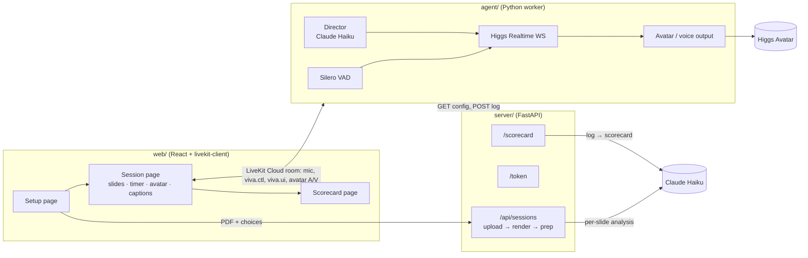

# Viva: an AI examiner for presentation defenses

**You present your slides. An examiner listens, cuts in when a claim doesn't hold up, keeps you to time, fact-checks you on the web, runs Q&A in English, Indonesian or Mandarin, and gives you a scorecard.**

Built for the Boson AI × MScAC Higgs Audio Hackathon 2026, track *Put a Face to the Voice*. The examiner is a [Higgs Avatar](https://docs.boson.ai) driven by `higgs-realtime-1.5-preview`.

<!-- TODO before submission: demo video link, team names and GitHub handles. -->
**Demo video:** _TODO_ · **Team:** _TODO_

## The problem
Every AI is built to be your assistant. Practising a thesis defense, a capstone presentation or an assignment oral needs the opposite: an **examiner**. Someone who stops you at the weak claim, asks "better than *what*?", and doesn't let you run over time. Students rarely get to rehearse in front of a real examiner. Viva gives them one that is demanding but fair, and that tells them afterwards exactly where they lost marks.

## What it does
| | |
|---|---|
| **Knows your slides** | Before the session, Claude Haiku reads every slide (image + text) and lists its claims, weak points and likely questions. During the session, the examiner always knows which slide you're on. |
| **Interrupts at the next breath** | A director model reads your live transcript. When you make a weak claim ("our model is 40% better"), the examiner cuts in at your next pause: *"Better than what? What's the baseline?"* |
| **Holds the floor** | When the examiner speaks, it keeps the floor briefly instead of yielding to the first sound you make. |
| **Keeps time, and checks you listened** | It gives a reminder at T−2 min and at time-up. If you talk straight through a reminder, it escalates once: *"Let me stop you there."* The reminder also appears on screen. |
| **Fact-checks on the web** | Checkable claims about the outside world ("LightGBM, released by Google in 2020") are verified with Higgs's server-side web search and corrected out loud. |
| **Runs Q&A, in your language** | It asks questions from the weak points it found. You can answer in Indonesian or Mandarin, or mix them with English, and it follows you. |
| **Scorecard** | A spoken verdict, then a page with scores for clarity, rigour, handling questions and time management, timestamped strong and weak moments quoting your own words, ignored reminders, and the top 3 improvements. |
| **Custom examiner** | Three preset characters (The Skeptic, The Supervisor, The Industry Panelist), each with its own avatar, interruption rate and strictness, plus a free-text brief of your own. The character, not hard-coded rules, decides how often she interrupts and for what. |

## How it uses Higgs
- **Manual turn control** (`turn_detection: null`). Presenter audio streams continuously. Our own VAD commits a chunk at each breath, which gives a transcript **without** an automatic reply. We decide when the examiner speaks (`response.create` with per-response instructions carrying the director's cue). That is what makes interruptions, holding the floor and our own barge-in policy possible.
- **Clean cancellation:** `response.cancel` → avatar `clear_buffer()` → `conversation.item.truncate`, so the transcript matches what was actually heard (the server confirms the cancel in about 31 ms).
- **Server-executed `web_search`** for live fact-checks.
- **Code-switching** in Q&A, and `higgs-stt-3.1` for presenter captions.
- **Higgs Avatar** realtime sessions on LiveKit Cloud (preset avatars), with a voice-only fallback (`VIVA_AVATAR=0`).
- Phase changes (presentation → Q&A → debrief) use instructions-only `session.update` mid-session.

## Architecture


- **`web/`**: Vite + React + TypeScript. The Session page talks to the agent over LiveKit text streams: `viva.ctl` (start, slide changes, phases) and `viva.ui` (examiner state, captions, reminders, fact-checks, latency).
- **`server/`**: FastAPI. Mints LiveKit tokens, renders uploaded PDFs with PyMuPDF, runs the per-slide Haiku analysis in parallel (structured outputs), serves the session config to the agent, stores the session log and generates the scorecard.
- **`agent/`**: a hand-built worker. It joins the room, starts the avatar and drives a raw Higgs Realtime WebSocket. It owns turn-taking: VAD commits, the director, holding the floor, the timer, phases, fact-checks and the session log.
- The A↔B interface (identities, message shapes, API) is pinned in [`PLAN.md`](PLAN.md) → "Interfaces between A and B".

## Setup
**You need:** [uv](https://docs.astral.sh/uv/) (it installs Python 3.12 itself), Node.js 22+ (or 20.19+), a [LiveKit Cloud](https://cloud.livekit.io) project (the avatar refuses self-hosted LiveKit), a Boson AI API key and an Anthropic API key.

```bash
cp .env.example .env          # fill in BOSON_API_KEY, LIVEKIT_URL/KEY/SECRET, ANTHROPIC_API_KEY
(cd server && uv sync)
(cd agent && uv sync)
(cd web && npm install)
```
Everyone running parts of the system must use the **same LiveKit project**, or the browser and the agent never meet.

## Run
Three terminals:
```bash
cd server && uv run uvicorn main:app --reload --port 8000
cd web && npm run dev                      # http://localhost:5173
cd agent && uv run main.py <session_id>    # one agent per session
```
1. Open http://localhost:5173. Pick a scenario and an examiner, upload a slides PDF, set the time, and click **Prepare my examiner** (about 5–10 s).
2. You land on `/session/<session_id>`. Start the agent with that id (`uv run main.py <session_id>`), wait for `ready`, then click **Start presentation** and allow the microphone.
3. Present. Use ← → or a presentation clicker to change slides. Use **Go to Q&A** and **End** to move between phases, or let the timer do it.
4. When the session ends, open the scorecard. The first time, it takes about 15 s to write.

After an exam, the agent stays in the room and waits for the next **Start**. Pressing Start again, or leaving the page, resets it to a fresh exam with a new log.

**The built-in demo session** needs no upload: `uv run main.py demo`, then open http://localhost:5173/session/demo.
**Voice-only** (no avatar slot used): `VIVA_AVATAR=0 uv run main.py <session_id>`.
**Use a wired headset**: speakers feed the examiner's voice back into the mic.

### Without any keys
- http://localhost:5173/session/demo?fake=1 replays a recorded session (`demo/sample-log.jsonl`) through the real UI. Add `&speed=4` to fast-forward.
- http://localhost:5173/scorecard/demo shows the sample scorecard.

## Example inputs and outputs (`demo/`)
| File | What it is |
|---|---|
| `deck.pdf` + `deck-outline.md` | "ERwait", an 8-slide internship project with **planted weaknesses**: "40% better" with no baseline, a target-leakage feature, a wrong fact about LightGBM, a crammed slide and a deployment overclaim |
| `deck-coding.pdf` + `deck-coding-outline.md` | "GradeBook", an easy 6-slide intro-programming assignment (bubble sort called O(n log n), "`sorted()` uses quicksort", "5x faster" with no baseline) that anyone can follow |
| `prepped-analysis.json`, `prepped-analysis-coding.json` | The per-slide analysis Haiku produced for each deck |
| `session-config.json` | A full SessionConfig, as the agent receives it |
| `sample-log.jsonl` | A session log in the contract format |
| `sample-scorecard.json` | The scorecard shape |
| `characters.json` | The three examiner presets |

## Testing
- **Prep (kill test K6):** `cd server && uv run python prep.py data/demo` analyses the 8-slide deck in about 3–8 s and catches every planted weakness.
- **Scorecard:** `cd server && uv run python scorecard.py ../demo/sample-log.jsonl ../demo/session-config.json`. Every quote is checked against the log: its time and slide come from the log line, and anything that isn't verbatim is dropped.
- **Agent, headless:** `cd agent && uv run probes/exam_sim.py` runs a full shortened exam on the demo deck (real Higgs and Haiku, simulated playback). The kill-test probes for manual turns, cancellation and Q&A mode are in `agent/probes/`.
- **Full stack, headless:** web + server + agent were run together with a synthesized presenter as the browser's fake microphone. Start, greeting, captions, slide changes, an interjection (2.4 s after the pause), Q&A, verdict, log upload and scorecard all worked (`server/CLAUDE.md` → "First live integration").
- Design notes and measured results for each part: `agent/CLAUDE.md`, `server/CLAUDE.md`, `web/CLAUDE.md`.

## Known limitations
- **Interruptions land at pauses, not mid-sentence.** The examiner cuts in at your next breath, typically **2–3.5 s** after the claim: VAD pause (0.6 s) + transcript (~0.4–1 s) + director (Claude Haiku, ~0.9–3.4 s, median ~2 s) + first audio (~0.45 s), plus avatar rendering.
- **Limited interruptions, by design.** To avoid nagging, the examiner never interrupts in the first 20 s, at most once per slide, and waits 20–45 s between interjections, depending on the character. Only the strictest character (The Skeptic) interrupts for minor issues; the others save them for Q&A. Even so, it can use an interruption on one weakness and have to let a bigger one a few seconds later pass: in an early test it questioned an unsourced statistic and then stayed quiet on "40% better".
- **The preview model's own turn-taking can't be switched on mid-session** (`turn_detection` is fixed at session start). Q&A therefore also runs on our manual turns: end-of-turn and barge-in come from our VAD and policy, not Higgs's built-in VAD.
- **Speech-to-text:** short Indonesian phrases transcribe unreliably, so treat captions and scorecard quotes in Indonesian as approximate. STT occasionally invents a sentence from silence, and it can split a sentence at a breath (e.g. losing "percent better").
- **Web-search follow-ups are sometimes unreliable** in wording or length. If the follow-up hasn't arrived after 12 s, the examiner gives the correction from memory instead.
- **Avatar capacity is shared** across all hackathon teams, and the avatar adds latency. If no slot is free, run voice-only (`VIVA_AVATAR=0`).
- **The agent is started by hand for each session** (`uv run main.py <session_id>`). There is no automatic dispatch yet.
- **No authentication.** `/token` issues a LiveKit token for any room and identity, and uploads are stored on the server's disk (`server/data/`). This is a local demo setup, not a deployment.
- **The scorecard is an LLM judgement.** Quotes, timestamps, slides and ignored reminders are verified against the log in code, but the scores and comments are Claude Haiku's opinion.
- **`demo/deck.pdf` is generated** from `demo/deck-outline.md` by a script, not designed by hand. <!-- TODO: remove if replaced by a hand-made deck -->
- <!-- TODO after the live run with a person and the avatar: add measured perceived latency and anything else that didn't hold up. -->

## Repo layout
```
agent/     examiner runtime: main.py, exam.py, realtime.py, director.py, vad.py, output.py, prompts/, probes/
server/    FastAPI: main.py, session_create.py, sessions.py, prep.py, scorecard.py, render.py, livekit_token.py
web/       React app: pages/ (Setup, Session, Scorecard), components/ (one per file), lib/ (contract, LiveKit link, fake agent)
demo/      decks, fixtures and cached outputs (see above)
docs/      fetch_vendor_docs.py (downloads the Boson docs locally)
PLAN.md    design decisions, build stages, the A↔B interface contract
```

## Built with
Higgs Realtime 1.5 preview, Higgs STT 3.1, Higgs Avatar and Higgs TTS (for test audio) from Boson AI · LiveKit Cloud · Claude Haiku 5.5 (slide analysis, director, scorecard) · FastAPI · PyMuPDF · React + Vite · Silero VAD.
